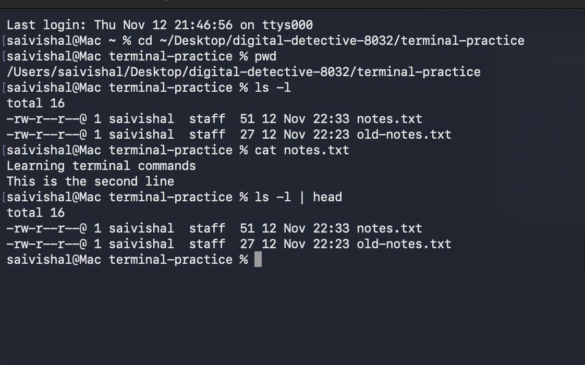

# Mission 2 - Terminal and File Management

## Work Completed

### Basic Terminal Operations

I practised different Terminal commands to understand how files and folders are managed.

| Operation | Command | What It Does |
|---|---|---|
| Current directory | `pwd` | Shows the current folder path |
| List files | `ls` | Lists files and folders |
| Detailed listing | `ls -l` | Shows detailed file information |
| Move to parent | `cd ..` | Moves to the parent folder |
| Create folder | `mkdir` | Creates a new folder |
| Create file | `touch` | Creates an empty file |
| Copy file | `cp` | Creates a copy of a file |
| Move or rename | `mv` | Moves or renames a file |
| Read file | `cat` | Displays file contents |

### File Operations

I created a folder called `terminal-practice` and practised creating, copying and renaming files.

I used `echo` to write text into a file.

- `>` replaces the existing content.
- `>>` adds new text at the end of the file.

I used `cat` to check the contents after writing.

### Flags and Pipes

A flag changes how a command works. For example:

- `ls` displays a normal list.
- `ls -l` displays a detailed list.

A pipe (`|`) sends the output of one command as input to another command.

Example:

`ls -l | head`

This displays the first few lines of the detailed listing.

### Homebrew

I checked Homebrew using these commands:

- `brew --version`
- `brew list`

## My Understanding

I learned how to navigate through folders and manage files using Terminal. I also understood the difference between copying and moving files, and how flags and pipes are useful.

## Difficulties Faced

Initially, I was confused about the difference between `>` and `>>` and how to use pipes.

## How I Resolved Them

I practised the commands using sample files and checked the results using `cat` and `ls`.

## Evidence

## Commit Details

The Terminal practice and README file were committed and pushed to GitHub.