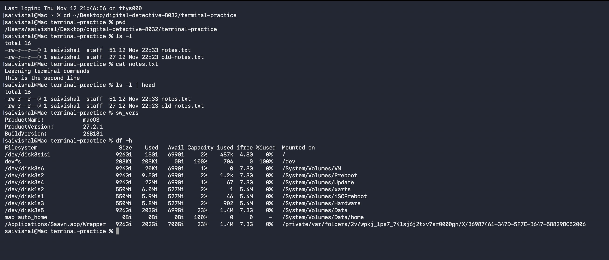

# Mission 3 - Exploring the Operating System

## Work Completed

### Exploring the Operating System

I used Terminal commands to learn more about my macOS system.

| Command | Purpose |
|---|---|
| `sw_vers` | Displays macOS version information |
| `whoami` | Displays the current username |
| `df -h` | Shows disk space usage |
| `top -l 1` | Displays a snapshot of running processes |

### Understanding Processes

A process is a program that is currently running on a computer.

A PID (Process ID) is a unique number assigned by the operating system to identify a running process.

Examples of processes include Finder and Terminal.

### Paths

There are two common types of paths:

- **Absolute Path:** The complete path starting from the root directory `/`.
- **Relative Path:** The path based on the current working directory.

### File Permissions

File permissions control what users can do with files and folders.

| Permission | Meaning |
|---|---|
| `r` | Read |
| `w` | Write |
| `x` | Execute |

### Responsibilities of an Operating System

| Responsibility | Explanation |
|---|---|
| Process Management | Manages running programs |
| Memory Management | Allocates memory to programs |
| File Management | Organises files and folders |
| Device Management | Manages connected hardware |
| Security | Controls access and permissions |

## My Understanding

I understood that an operating system manages the hardware and software resources of a computer. It also manages memory, files, processes and permissions.

## Difficulties Faced

I initially found it difficult to understand the output of commands such as `df -h` and `top`.

## How I Resolved Them

I practised the commands and learned what each command displays.

## Evidence

## Commit Details

The operating system concepts and practical work were documented and pushed to GitHub.